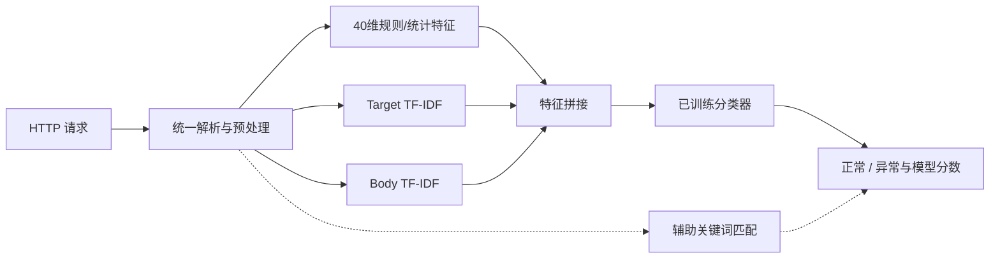
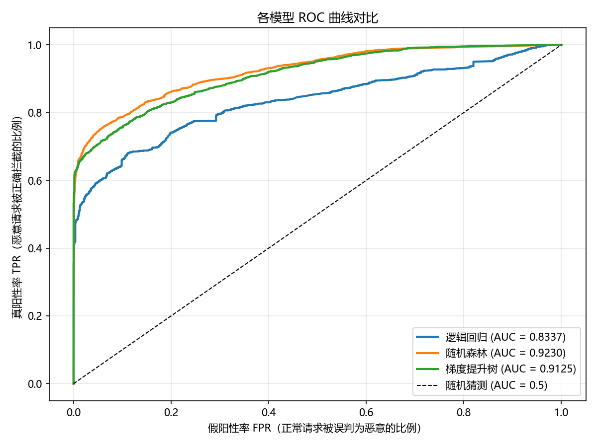
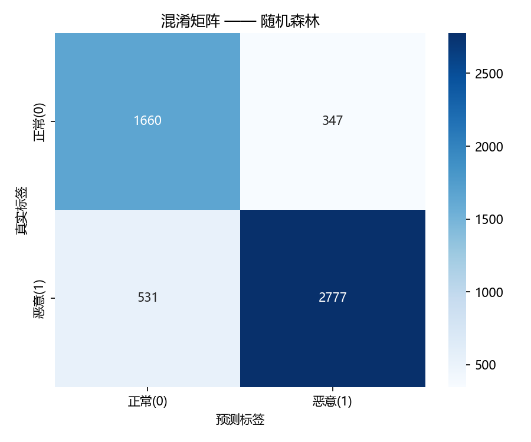

# HTTP Request Anomaly Detection

**基于机器学习的恶意 HTTP 请求识别**

对单条 HTTP 请求进行正常/异常二分类。系统将规则与统计特征、请求目标和请求体的 TF-IDF 表示结合，在同一特征管线上比较逻辑回归、随机森林和 XGBoost，并提供命令行与 Streamlit 交互入口。

[快速开始](#快速开始) · [数据与复现](#数据与复现) · [实验结果](#实验结果) · [实现说明](#实现说明) · [项目结构](#项目结构) · [常见问题](#常见问题)

## 可以做什么

- 解析完整 HTTP 报文、简化请求行或裸 URL，显示方法、请求目标、查询串、请求头和请求体。
- 保留原始文本，对请求目标和请求体执行最多三轮百分号解码，构造数值与文本特征。
- 训练三个传统机器学习模型，输出指标汇总、混淆矩阵、ROC 曲线和特征重要性图。
- 将选中的模型与拟合后的特征管线一起保存，供 CLI 和 Streamlit 复用。
- 展示二分类结果、模型分数及辅助关键词匹配，便于检查输入内容。

这是单请求离线分析原型。模型输出不代表攻击已经成功，也不直接执行流量拦截；关键词匹配是辅助信息，不是模型决策的因果解释。

## 快速开始

### 1. 安装环境

使用 Python 3.10 或更新版本。克隆仓库后，在项目根目录执行：

```bash
git clone https://github.com/honghaow607-stack/http-request-anomaly-detection.git
cd http-request-anomaly-detection
python -m venv .venv
```

macOS / Linux：

```bash
source .venv/bin/activate
python -m pip install -r requirements.txt
```

macOS若尚未安装OpenMP运行库，先通过Homebrew安装XGBoost所需的运行库：

```bash
brew install libomp
```

Windows PowerShell：

```powershell
.venv\Scripts\Activate.ps1
python -m pip install -r requirements.txt
```

### 2. 准备数据并训练

固定实验数据模式：准备参考实验所用的两份 CSIC 文件及随仓库提供的五份合成数据，检查 SHA256 后构建数据集。

```bash
python tools/prepare_data.py --mode paper
python run.py
```

已有原始 CSIC 文件时，可跳过网络下载：

```bash
python tools/prepare_data.py --mode paper --source-dir /path/to/original/data/raw
python run.py
```

只想离线体验流程，可在一个干净的工作副本使用合成数据模式：

```bash
python tools/prepare_data.py --mode synthetic
python run.py
```

合成模式不需要下载 CSIC，使用仓库附带的固定样本。它产生的成绩与下方参考实验不同。`paper` 模式下载失败或文件哈希不符时会停止，不会悄悄切换成合成实验。

> 先准备数据，再运行 `run.py`。原训练入口读取已有数据或缓存，不负责首次下载。切换数据模式前，请先备份并移走旧的 `data/raw/` 和 `data/processed/`，或使用新的工作副本；准备脚本会拒绝会改变实验构成的额外原始文件。

训练完成后，项目根目录生成 `model.pkl`，`results/` 下生成本次指标与图表。作者原始结果单独保存在 [`results/reference/`](results/reference/)，不会被训练脚本覆盖。

### 3. 预测单条请求

```bash
python src/predict.py --file examples/normal_request.txt
python src/predict.py --file examples/encoded_request.txt
python src/predict.py --text "GET /index.html HTTP/1.1"
```

不带参数运行可粘贴多行报文，最后单独输入 `END`：

```bash
python src/predict.py
```

示例文件用于演示输入格式；README不预设它们一定得到某个预测结果。预测必须使用自己训练得到的模型。

### 4. 启动网页

```bash
streamlit run src/app.py
```

按终端提示打开本地地址，通常为 `http://localhost:8501`。页面展示请求字段、二分类结果、分数和命中关键词。

## 实现说明



### 特征表示

| 特征块 | 维数或上限 | 内容 |
|---|---:|---|
| 方法指示 | 7 | GET、POST、PUT、DELETE、HEAD、OPTIONS、PATCH |
| 长度与结构 | 7 | 字段长度、查询参数数目、路径深度 |
| 标点与密度 | 15 | 14项字符/字符串计数与1项密度 |
| 编码与路径模式 | 5 | 百分号转义、编码比例、双重编码迹象、斜杠和遍历模式 |
| 目标字符熵 | 1 | 请求目标的字符分布熵 |
| 关键词计数 | 5 | 四类关键词列表命中数及总数 |
| Target TF-IDF | 最多1,000 | 原始与解码后的请求目标，词级1—2元组 |
| Body TF-IDF | 最多500 | 原始与解码后的请求体，词级1—2元组 |

参考实验中两块词表均达到上限，合计1,540维；小数据演示可能得到更小的维度。TF-IDF只在训练分区拟合，评估和预测使用同一词表。数值特征未另外缩放。

### 预处理与输出边界

- 解码使用百分号解码，最多三轮，文本不再变化时提前停止；不把表单中的 `+` 自动换为空格。
- 请求头被保留供展示，但分类器使用的是请求头长度，不是请求头内容的词法表示。
- 分类器只输出正常/异常二分类。SQL注入、XSS、路径遍历和命令注入的关键词提示不等于另一个经过训练的攻击类型分类器。
- 接口中的“恶意概率”对应 `predict_proba` 的正类分数；本项目没有进行概率校准。当前标签阈值为0.5。

## 数据与复现

### 固定参考实验的数据构成

CSIC 2010是为电商应用生成的HTTP基准流量。其异常标签包含多种非法或异常请求，不应将所有标签直接解释为已经证实的恶意行为。数据归属和类别说明见[CSIC作者文档存档](https://petescully.co.uk/wp-content/uploads/2018/04/http_dataset_csic_2010.pdf)。下载镜像位于原作者之外，文件哈希用于固定本项目使用的具体版本。

| 数据源 | 解析请求数 | 清洗去重后 |
|---|---:|---:|
| CSIC `anomalousTrafficTest.txt` | 25,065 | 15,964 |
| CSIC `normalTrafficTest.txt` | 36,000 | 9,622 |
| 合成正常请求 | 500 | 410 |
| 合成SQL注入 | 150 | 148 |
| 合成XSS | 150 | 148 |
| 合成路径遍历 | 150 | 135 |
| 合成命令注入 | 150 | 145 |
| **合计** | **62,165** | **26,572** |

保留记录中，正常请求10,032条，异常请求16,540条。固定实验没有使用 `normalTrafficTrain.txt`。清洗去除空请求目标，并按 `(method, url, body, label)` 去重。

[`docs/data_manifest.json`](docs/data_manifest.json)记录七份原始输入的SHA256、大小和请求数量。CSIC镜像固定到具体commit，并记录统一LF换行后的SHA256：已核对镜像与原文件的内容一致，仅CRLF/LF换行不同，准备工具只接受原始哈希或这一明确的换行归一化哈希。五份原始合成文件位于 [`data/synthetic/`](data/synthetic/)。仓库不重复打包CSIC原始文件、处理后CSV或大体积模型；它们由准备与训练步骤生成。

### 训练与评估配置

- 分层80/20划分，随机种子42；训练21,257条，评估5,315条。
- 评估分区包含2,007条正常、3,308条异常请求，其中199条来自本地合成数据。
- LR：`max_iter=5000`、`C=1.0`、`class_weight="balanced"`。
- RF：200棵树、平衡类别权重、可用CPU并行。
- XGBoost：200轮、学习率0.1、最大深度6，正类权重为训练集正常/异常数量之比。
- 实现按评估召回率优先、F1次之选择保存模型；三个模型使用共同特征矩阵。

更多复现细节、固定数据与演示模式的区别见 [`docs/REPRODUCIBILITY.md`](docs/REPRODUCIBILITY.md)。依赖文件给出最低版本，未冒充原实验的完整环境锁；不同软件版本可能改变默认值和结果。

发布前已验证固定数据下载与解析、离线三模型训练、CLI预测和网页预测。环境与检查范围见 [`docs/SMOKE_TEST.md`](docs/SMOKE_TEST.md)；这些运行检查不替代上表所述参考实验。

## 实验结果

下表来自作者随项目提供的 [`metrics_summary.csv`](results/reference/metrics_summary.csv)，属于固定混合数据划分的既有实验结果，不是本次仓库整理重新测出的成绩。

| 模型 | Accuracy | Precision | Recall | F1 | ROC-AUC | FPR |
|---|---:|---:|---:|---:|---:|---:|
| 逻辑回归 | 0.7511 | 0.9144 | 0.6620 | 0.7680 | 0.8337 | 10.21% |
| 随机森林 | **0.8348** | 0.8889 | **0.8395** | **0.8635** | **0.9230** | 17.29% |
| XGBoost | 0.8017 | **0.9458** | 0.7228 | 0.8194 | 0.9125 | **6.83%** |

FPR由原始混淆矩阵计算。随机森林按当前规则被选中：检测到2,777/3,308条异常请求，同时将347/2,007条正常请求标为异常。XGBoost检测到2,391条异常请求，误报137条正常请求。选择较高召回率意味着这里需要承担更多误报，应结合实际使用成本解释。

<details>
<summary>查看原始ROC与随机森林混淆矩阵</summary>





其余混淆矩阵和特征重要性图位于 [`results/reference/`](results/reference/)。图像保留原始输出，特征重要性不能单独证明某条请求为何被分类。

</details>

### 当前证据范围

现有实验是单次划分的描述性比较；选模与最终测试没有由独立验证分区隔离。尚未通过消融验证数值特征、TF-IDF、解码或合成数据各自的收益，也未验证跨站点泛化、抗绕过能力、延迟或生产阻断性能。原始记录去重不保证特征表示彼此不同。

因此，本仓库不把这些结果称为SOTA或生产部署成绩。后续优先补充独立评估、特征块对照、分来源指标及基于验证集的阈值选择。

## 项目结构

```text
.
├── README.md
├── requirements.txt
├── run.py                      # 训练、评估、选模与序列化
├── src/
│   ├── data_loader.py          # 请求文件解析、生成器与数据清洗
│   ├── preprocess.py           # 单请求解析、解码与文本准备
│   ├── features.py             # 数值特征与两块TF-IDF
│   ├── models.py               # LR / RF / XGBoost
│   ├── evaluate.py             # 指标、ROC、混淆矩阵和重要性图
│   ├── predict.py              # CLI预测
│   └── app.py                  # Streamlit界面
├── tools/prepare_data.py       # 固定数据准备、哈希检查与离线模式
├── examples/                  # 完整报文输入示例
├── data/synthetic/            # 固定合成样本
├── results/reference/         # 作者提供的既有结果
└── docs/
    ├── REPRODUCIBILITY.md
    ├── data_manifest.json
    └── source_manifest.json
```

运行产生的 `data/raw/`、`data/processed/`、`model.pkl` 和 `results/` 根目录输出均被 `.gitignore` 排除。`run.py` 和 `src/` 保留原项目实现，发布时新增数据准备工具及文档；原实现文件的校验记录见 [`docs/source_manifest.json`](docs/source_manifest.json)。

## 常见问题

**找不到 `model.pkl`。** 先完成数据准备并运行 `python run.py`。仓库不附带预训练模型，预测接口需要本地训练产物。仅加载自己训练或确认可信来源的joblib/pickle文件。

**下载失败或SHA256不匹配。** `paper` 模式不会自动换数据。可用 `--source-dir` 指向原始数据文件夹；只想查看运行流程时，在干净副本选择 `synthetic` 模式。

**更换数据后结果没有变化。** 原训练入口优先读取 `data/processed/dataset.csv`。使用准备工具重建缓存；不要把旧缓存与新数据混用。

**特征维度不足1,540。** 1,000和500是词表上限，不是所有数据集都能达到的固定维度。合成小样本的词表可能更小。

**macOS报 `Library not loaded: @rpath/libomp.dylib`。** 安装 `brew install libomp` 后重试。若使用虚拟环境，也应在同一环境验证 `python -c "import xgboost"`。

**网页端口被占用。** 指定其他本地端口：

```bash
streamlit run src/app.py --server.port 8502
```

**换一个模型或调整阈值。** 模型定义位于 `src/models.py`。当前CLI与网页通过 `src/predict.py` 中的阈值逻辑预测；调整规则后应统一两端口径，并在验证数据上选择阈值。

## 项目与数据归属

CSIC 2010的作者为C. Torrano Giménez、A. Pérez Villegas和G. Álvarez Marañón。请按数据源要求使用和引用基准数据。合成样本由本项目生成器产生，用于本地流程演示与固定实验构成。

使用本项目开展实验时，请记录仓库地址、commit版本、数据清单和运行环境。相关论文尚在撰写，当前仓库不提供已发表论文或DOI信息。代码许可证尚待作者确定，仓库未添加未经确认的许可证。
